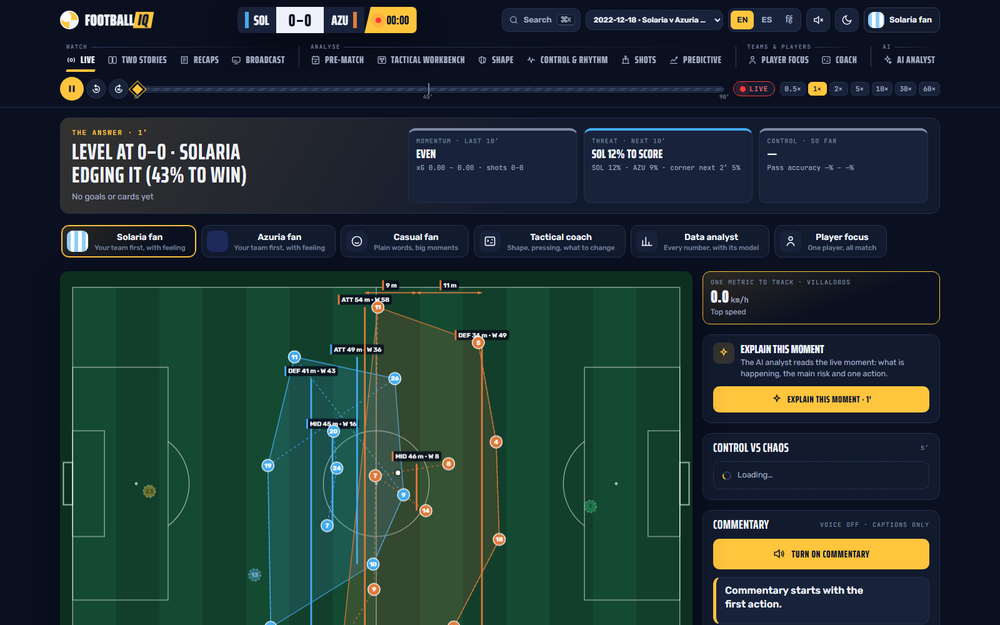
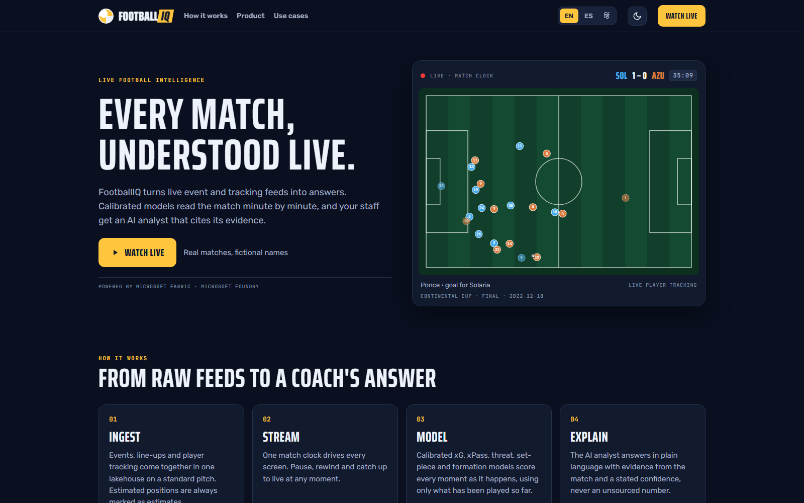
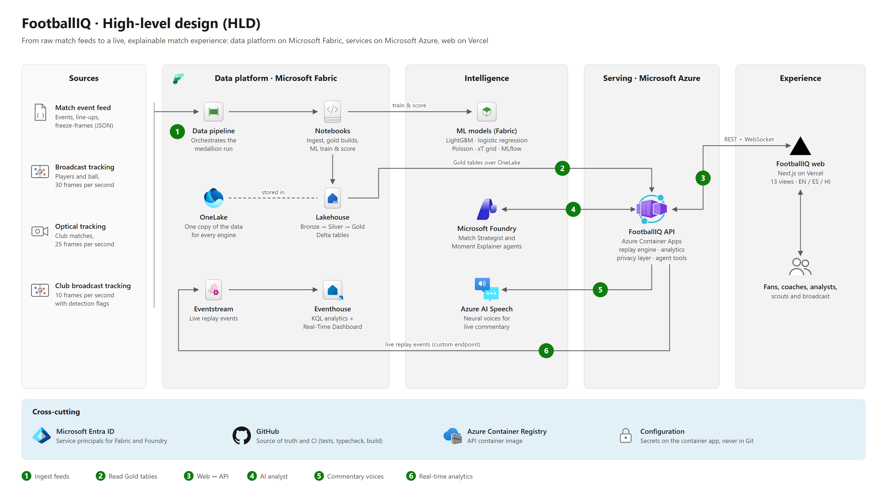

# FootballIQ

**Every match, understood live.** FootballIQ replays a football match as if it were happening now. Player
tracking, calibrated models and an AI analyst that cites its evidence all run on one match clock, and every number
uses only what has been played up to that clock.



## Features

- **One clock, thirteen views.** Live, Two stories, Recaps, Broadcast, Pre-match, Tactical workbench, Shape, Control & rhythm,
  Shots, Predictive, Player focus, Coach and AI analyst. Pause, rewind or jump to any minute and every view rebuilds
  from that moment.
- **Perspectives.** The same moment told for a home or away fan, a casual viewer, a tactical coach, a data analyst or a player follower.
- **Calibrated models.** xG, xPass, expected threat, goal / corner / penalty forecasts and live win probability,
  each with an uncertainty band and a model card.
- **AI analyst.** A Match Strategist answers questions and a Moment Explainer reads the live moment, both on Microsoft
  Foundry. Every answer is backed by match data.
- **Live commentary.** Play-by-play and colour lines with neural voices in English, Spanish and Hindi.
- **Real matches, fictional names.** Every team, player, official and venue gets a consistent fictional identity.
- **No spoilers.** Scores, counters, insights and forecasts never look past the match clock.



## Data & attribution

The demo replays one real, publicly released match, the FIFA World Cup 2022 final, **fully pseudonymised**. Every
team, player, official, competition and venue has a fictional name, kits are invented, and no real name reaches the
app, the API or the AI agents. This repository contains no match data; the pipeline downloads it from the sources:

- **Events:** [StatsBomb Open Data](https://github.com/statsbomb/open-data), free for non-commercial use with attribution.
- **Player and ball tracking:** PFF FC (Gradient Sports) FIFA World Cup 2022 public data release.
- **Model training priors:** [martj42/international_results](https://github.com/martj42/international_results) (CC0) and
  [openfootball/football.json](https://github.com/openfootball/football.json).
- **Optional tracking feeds** supported by the pipeline: [SkillCorner open data](https://github.com/SkillCorner/opendata)
  and IDSSE / DFL open data (Bassek et al., 2025, CC BY 4.0).

Data © its providers. FootballIQ is not affiliated with or endorsed by them, FIFA or the Premier League.

## Architecture



| Layer | Runs on |
|---|---|
| Data platform: medallion lakehouse, ML training and scoring, real-time analytics | Microsoft Fabric (OneLake, Data pipeline, Spark notebooks, MLflow, Eventstream, Eventhouse) |
| FootballIQ API: replay engine, analytics, privacy layer, agent tools | Azure Container Apps (FastAPI) |
| AI analyst | Microsoft Foundry Agent Service |
| Commentary voices | Azure AI Speech |
| Web app | Next.js on Vercel |
| Identity | Microsoft Entra ID service principals |

The full set of diagrams is in [docs/ARCHITECTURE.md](docs/ARCHITECTURE.md): the HLD, a low-level design for data
ingestion on Fabric, a low-level design for the application, and a diagram of how everything connects.

## Repository layout

| Path | Contents |
|---|---|
| `backend/` | FastAPI service (`footballiq` package): replay engine, analytics, ML features, agents, commentary, privacy layer |
| `frontend/` | Next.js web app: the Matchday app at `/` and the landing page at `/welcome` |
| `fabric/` | Every Fabric item as code: notebooks, data pipeline, Eventstream, KQL, Real-Time Dashboard, deploy script |
| `docs/` | Architecture, Matchday API, commentary engine |
| `data/` | Local data folder for offline mode (git-ignored contents) |

## Getting started

Requirements: Python 3.11, Node.js 20 or later, and a Microsoft Fabric workspace that an Entra ID service
principal can read. Microsoft Foundry and Azure AI Speech are optional: without them the AI analyst and voiced
commentary are switched off and everything else works.

```bash
# configuration
cp .env.example .env              # fill in FABRIC_*, and FOUNDRY_* / AZURE_SPEECH_* if you use them

# backend
cd backend
python -m venv .venv
.venv/bin/pip install -e ".[dev,fabric]"       # Windows: .venv\Scripts\pip
.venv/bin/uvicorn footballiq.api.app:app --port 8000

# frontend (new terminal)
cd frontend
npm ci
npm run dev                       # http://localhost:3000
```

The API reads `.env` from the repository root automatically. Variables already set in the environment take precedence.
On Windows, start the API with `PYTHONUTF8=1` so logs handle every character set.

## Configuration

| Variable | Purpose |
|---|---|
| `FABRIC_TENANT_ID`, `FABRIC_CLIENT_ID`, `FABRIC_CLIENT_SECRET` | Service principal for the Fabric workspace |
| `FABRIC_WORKSPACE_NAME`, `FABRIC_LAKEHOUSE_NAME` | Where the Gold tables live |
| `FOOTBALLIQ_SOURCE` | `fabric` (default) reads the lakehouse; `local` reads `data/silver` |
| `FOOTBALLIQ_PRELOAD` | Matches warmed into memory at startup |
| `FOOTBALLIQ_MATCHES` | Matches the app offers (empty = the whole catalogue); the demo offers only the final |
| `FOOTBALLIQ_CACHE_MATCHES` | In-memory match cache size |
| `FOOTBALLIQ_CORS_ORIGINS` | Web origins allowed to call the API |
| `FOOTBALLIQ_EVENTSTREAM` | `on` publishes replay events to Fabric Eventstream |
| `FOUNDRY_PROJECT_ENDPOINT`, `FOUNDRY_TENANT_ID`, `FOUNDRY_CLIENT_ID`, `FOUNDRY_CLIENT_SECRET`, `FOUNDRY_MODEL` | AI analyst |
| `AZURE_SPEECH_KEY`, `AZURE_SPEECH_REGION` | Voiced commentary |
| `NEXT_PUBLIC_API_URL` | API address the web app calls (set at build time) |

See [`.env.example`](.env.example) for the full list.

## AI analyst

```bash
footballiq-agents setup           # create or update both Foundry agents by name; prints their ids
footballiq-agents ask "What should the trailing team change?" --at-ms 4500000
```

The agents call the API's match tools (context, stats, key events, forecasts, shot quality, tactical shape, physical
load, player form, substitutions). The server binds every tool to the replay clock of the request, so an answer can
never use anything that happens later in the match.

## API

| Endpoint | Purpose |
|---|---|
| `GET /v1/matches` | Available matches |
| `GET /v1/matches/{id}/overview` | Teams, rosters and periods (no result) |
| `GET /v1/matches/{id}/state?at_ms=` | Score, period, clock and live counters at `at_ms` |
| `GET /v1/matches/{id}/events?to_ms=&from_ms=` | Events up to the replay cutoff |
| `GET /v1/matches/{id}/freeze-frame?at_ms=` | Player positions captured with the nearest event |
| `WS /v1/matches/{id}/replay` | Live replay: `reset`, `event`, `state` and `snapshot` messages; send `play`, `pause`, `speed`, `seek` |
| `POST /v1/matches/{id}/agents/ask` | Match Strategist: `{question, at_ms, thread_id?}` |
| `POST /v1/matches/{id}/agents/explain` | Moment Explainer: `{at_ms}` |

Match, team and player ids in the API are public aliases (for example `m-xxxxxx`). Matchday endpoints are documented
in [docs/MATCHDAY_API.md](docs/MATCHDAY_API.md) and the commentary engine in [docs/COMMENTARY.md](docs/COMMENTARY.md).

## Data platform

All Fabric items are kept in [`fabric/`](fabric/README.md) and deployed with the service principal:

```bash
set -a; source .env; set +a
python fabric/scripts/fabric_bootstrap.py all     # deploy the items, run the pipeline, verify every table
```

## Tests

```bash
cd backend && pytest -q
cd frontend && npm run typecheck && npm run build
```

CI runs both on every push.

## Deployment

The API runs on Azure Container Apps, the web app on Vercel and voices on Azure AI Speech. See [DEPLOY.md](DEPLOY.md).
