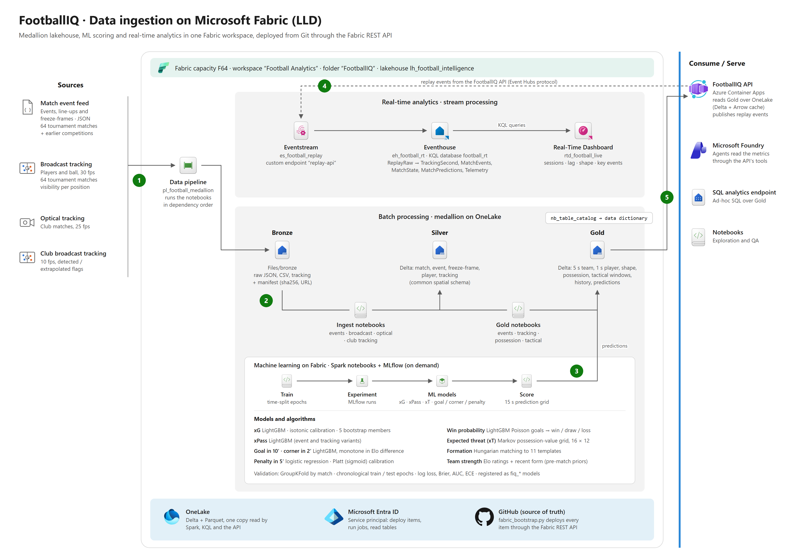
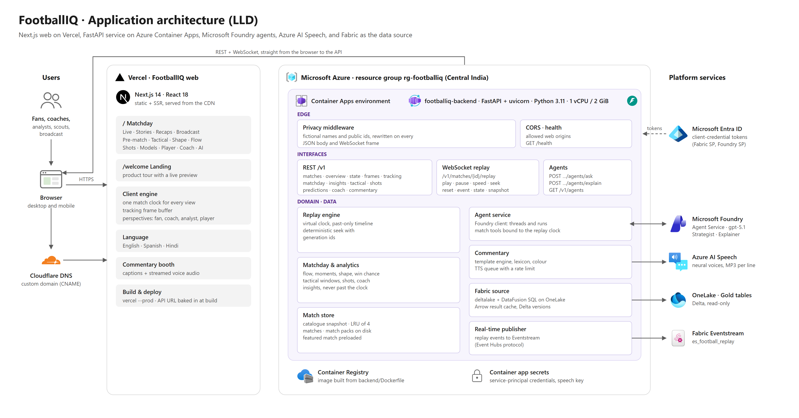
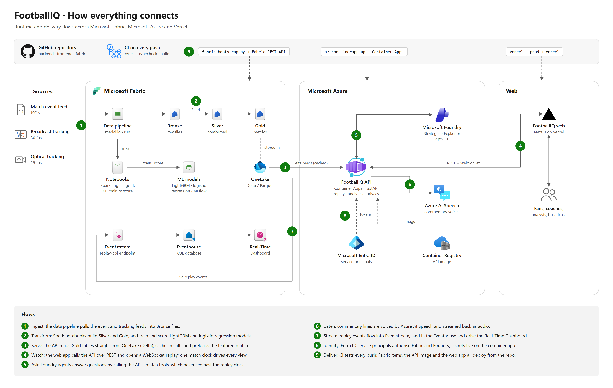

# FootballIQ architecture

The diagrams use the official Microsoft Fabric and Azure architecture icons. Each one is provided as SVG (scalable)
and PNG (2x).

| # | Diagram | What it shows |
|---|---|---|
| 1 | [High-level design](#1-high-level-design-hld) | Sources, data platform, intelligence, serving and experience on one page |
| 2 | [Data ingestion on Fabric (LLD)](#2-data-ingestion-on-microsoft-fabric-lld) | Medallion lakehouse, ML training and scoring, real-time analytics |
| 3 | [Application (LLD)](#3-application-lld) | The web app, the API's internal layers and the platform services it calls |
| 4 | [How everything connects](#4-how-everything-connects) | Numbered runtime and delivery flows across Fabric, Azure and Vercel |
| 5 | [Multi-agent framework (HLD)](#5-multi-agent-framework-hld) | How the agent team connects to the web app, the API, Foundry, Speech and Fabric, and what comes next |
| 6 | [Multi-agent orchestrator (LLD)](#6-multi-agent-orchestrator-lld) | The multi-stage pipeline: stages, gates, specialists, blackboard, match tools, run engine, measured runs |

## 1. High-level design (HLD)

- **Sources:** a match event feed (events, line-ups, freeze-frames), broadcast tracking at 30 fps, optical tracking at
  25 fps and club broadcast tracking at 10 fps.
- **Data platform (Microsoft Fabric):** one workspace holds the data pipeline, Spark notebooks, the lakehouse on
  OneLake (Bronze, Silver and Gold) and the real-time path (Eventstream, then Eventhouse).
- **Intelligence:** ML models trained and scored in Fabric, Microsoft Foundry agents for questions and explanations,
  and Azure AI Speech for commentary voices.
- **Serving (Azure Container Apps):** the FootballIQ API reads Gold tables over OneLake and serves the replay, the
  analytics and the agent tools.
- **Experience:** the Next.js web app on Vercel, used by fans, coaches, analysts, scouts and broadcasters.

[SVG](architecture/01-hld.svg)

## 2. Data ingestion on Microsoft Fabric (LLD)

| Step | Fabric item | What happens |
|---|---|---|
| 1 | Data pipeline `pl_football_medallion` | Runs the notebooks in dependency order. A `game_ids` parameter limits a run to chosen matches. |
| 2 | Ingest notebooks then Bronze, Silver | Raw files and manifests (sha256, URL) land in `Files/bronze`. Ingest notebooks conform them into Silver Delta tables: match, event, freeze-frame, player and tracking, all on one 105 × 68 m pitch with a common spatial schema. |
| 2 | Gold notebooks then Gold | Event, tracking, possession and tactical notebooks build the Gold tables: 5 s team metrics, 1 s player metrics, team shape, possession, tactical windows, passing networks, heatmaps, regains and history. |
| 3 | ML notebooks, Experiment, ML models | Train (on demand), track runs in MLflow, register `fiq_*` models, then score every match on a 15 s grid into Gold. |
| 4 | Eventstream then Eventhouse then Real-Time Dashboard | The API publishes replay events to the Eventstream custom endpoint. Update policies in the KQL database turn `ReplayRaw` into `TrackingSecond`, `MatchEvents`, `MatchState`, `MatchPredictions` and `ReplayTelemetry`, which drive the Real-Time Dashboard. |
| 5 | Consume / serve | The FootballIQ API reads Gold over OneLake (Delta, with an Arrow result cache). Analysts can also use the SQL analytics endpoint and notebooks. |

### Machine learning models

| Model | Algorithm | Notes |
|---|---|---|
| xG (expected goals) | LightGBM classifier | Isotonic calibration on grouped out-of-fold predictions; 5 bootstrap members give the uncertainty band |
| xPass | LightGBM classifier | An event-based model and a separate tracking-based model that also sees defender positions |
| Goal in next 10′, corner in next 2′ | LightGBM classifiers | Monotone constraint on Elo difference, so a stronger team is never rated less likely to score |
| Penalty in next 5′ | Logistic regression | Median imputation and scaling, with Platt (sigmoid) calibration because penalties are rare |
| Win probability | LightGBM Poisson regression | Predicts the goals left in the period, then converts them into win / draw / loss odds with independent Poisson counts |
| Expected threat (xT) | Markov possession-value grid (16 × 12) | Credits passes and carries by the change in possession value |
| Formation detection | Hungarian algorithm | Assigns players to each of 11 formation templates; the nearest template wins |
| Team strength (pre-match priors) | Elo ratings + recent form | World Football Elo convention, with K weighted by match importance |

Validation uses GroupKFold by match and chronological train / test epochs, so a match is only scored by models
trained before it. Each model reports log loss, Brier score, AUC and calibration error (ECE) against a base rate,
and appears on the model cards in the app.

[SVG](architecture/02-lld-data-ingestion.svg)

## 3. Application (LLD)

| Layer | Component | Responsibility |
|---|---|---|
| Web | Next.js 14 on Vercel | Matchday app (`/`) with 13 views, landing page (`/welcome`), one client match clock, tracking frame buffer, perspectives, EN / ES / HI, commentary booth |
| Edge | Privacy middleware | Turns public ids back into canonical ids on the way in, and rewrites every JSON body and WebSocket frame to fictional names and public ids on the way out |
| Interfaces | REST `/v1`, WebSocket replay, agents | Match data, Matchday, insights, tactical, shots, predictions, coach and commentary; live replay controls; Strategist and Explainer |
| Domain | Replay engine | Virtual clock, past-only timeline, deterministic seek with generation ids |
| Domain | Matchday & analytics | Flow, moments, shape, win chance, tactical windows, shots, coach, insights |
| Domain | Commentary | Template engine with lexicon and colour lines, and a rate-limited TTS queue to Azure AI Speech |
| Domain | Agent service | Foundry client (threads and runs) with match tools bound to the replay clock |
| Data | Match store | Catalogue snapshot, in-memory LRU of 4 matches, match packs on disk, featured match preloaded |
| Data | Fabric source | deltalake + DataFusion SQL over OneLake, Arrow result cache, Delta version checks |
| Data | Real-time publisher | Sends replay events to Fabric Eventstream over the Event Hubs protocol |

The browser calls the API directly over REST and WebSocket. Vercel serves the web app, and Cloudflare provides DNS
for the custom domain.

[SVG](architecture/03-lld-application.svg)

## 4. How everything connects

1. **Ingest:** the data pipeline pulls the event and tracking feeds into Bronze files.
2. **Transform:** Spark notebooks build Silver and Gold, and train and score the models.
3. **Serve:** the API reads Gold tables straight from OneLake (Delta), caches results and preloads the featured match.
4. **Watch:** the web app calls the API over REST and opens a WebSocket replay; one match clock drives every view.
5. **Ask:** Foundry agents answer by calling the API's match tools, which never see past the replay clock.
6. **Listen:** commentary lines are voiced by Azure AI Speech and streamed back as audio.
7. **Stream:** replay events flow into Eventstream, land in the Eventhouse and drive the Real-Time Dashboard.
8. **Identity:** Entra ID service principals authorise Fabric and Foundry; secrets live on the container app.
9. **Deliver:** CI tests every push; Fabric items (`fabric_bootstrap.py`), the API image (`az containerapp up`) and
   the web app (`vercel --prod`) all deploy from the repository.

[SVG](architecture/04-how-it-connects.svg)

## 5. Multi-agent framework (HLD)

1. **Ask and watch:** the AI tab (or "Ask the team" on the Live tab) posts the question with the replay clock,
   perspective and language, then polls the run's live trace.
2. **Ground:** the orchestrator's blackboard calls the match tools, which never see past the replay clock.
3. **Evidence:** the tools read Gold tables and ML scores from OneLake.
4. **Reason:** the planner, the specialists and the synthesizer run on gpt-5.1 in Microsoft Foundry.
5. **Verify:** numbers, minutes and source names are checked against the evidence before anything is delivered.
6. **Listen:** commentary lines are voiced by Azure AI Speech.

Dashed flows are planned: voiced team answers (7), agent traces in the Eventhouse (8) and in-play triggers from
Activator (9). See [MULTI_AGENT_HLD.md](MULTI_AGENT_HLD.md) for the design and the roadmap.

[SVG](architecture/05-multi-agent-hld.svg)

## 6. Multi-agent orchestrator (LLD)

| Stage | Runs on | Output | Gate to the next stage | Fallback |
|---|---|---|---|---|
| 0 Ground | code | match tools cut at `at_ms` | the match exists | run fails |
| 1 Plan | gpt-5.1, low reasoning, JSON | 1–4 tasks | at least one known specialist | keyword router |
| 2 Investigate | gpt-5.1 + tools, in parallel | one report per specialist | at least one report 35 s before the run budget ends | stragglers skipped |
| 3 Synthesize | gpt-5.1, low reasoning | the answer in the chosen perspective and language | non-empty answer | run fails |
| 4 Verify | deterministic rules | pass, warn or fail | clean, or one revision used | the better draft is kept |
| 5 Deliver | code | neutral sources, fictional names | n/a | n/a |

See [MULTI_AGENT_LLD.md](MULTI_AGENT_LLD.md) for the classes, the API, the failure modes and the tests.

[SVG](architecture/06-multi-agent-lld.svg)

## Security and identity

- Two Entra ID service principals use the client-credentials flow: one for Fabric (deploy items, run jobs, read tables)
  and one for Microsoft Foundry (agents).
- Secrets are stored as Container Apps secrets and never committed. `.env` is git-ignored, and `.env.example` lists the names only.
- The privacy middleware fails closed: if a response cannot be anonymised, the client gets an error instead of the original.

The icons are © Microsoft and are used under Microsoft's terms for architecture diagrams and documentation.
