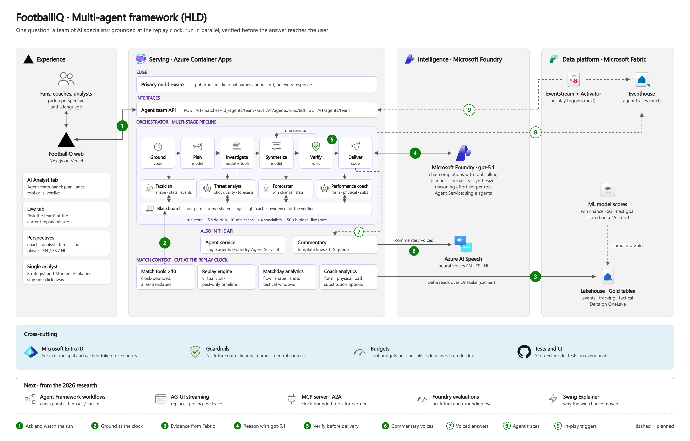
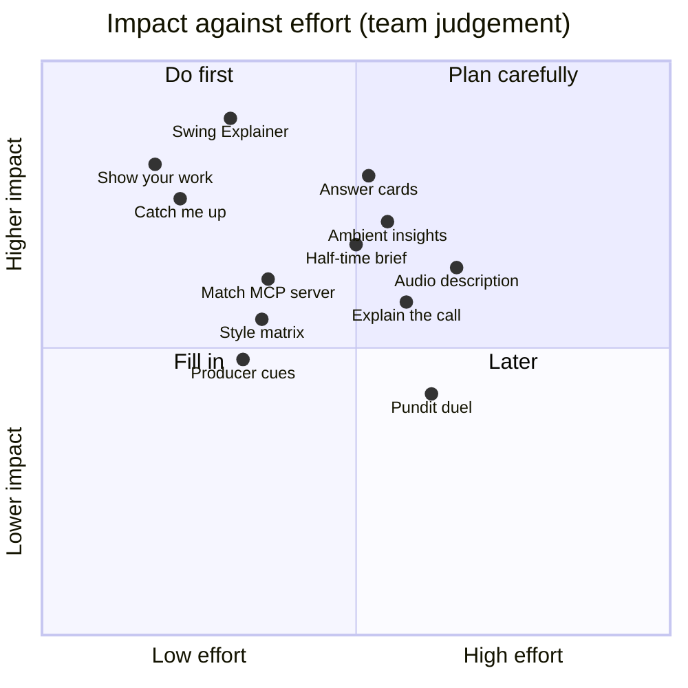
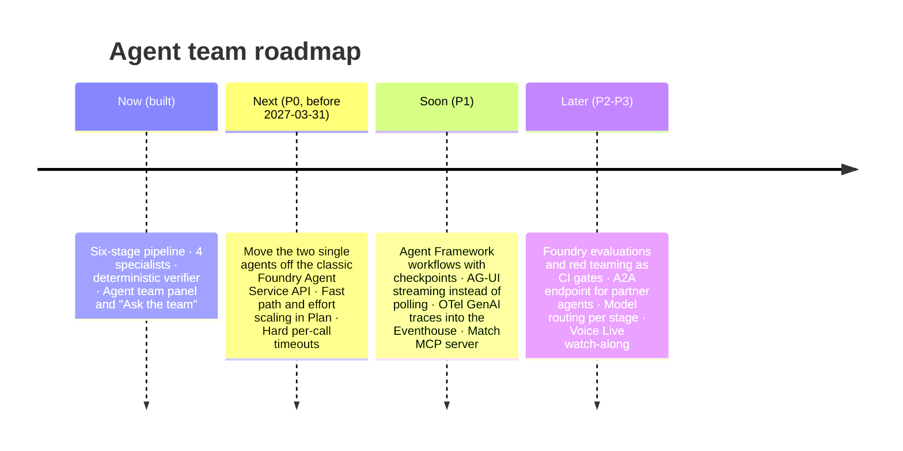

# Multi-agent framework: high-level design

**Scope:** what the FootballIQ agent team is, how it connects to every part of the product, and how it grows into
product features. **Companion:** the implementation (classes, API, failure modes, tests) is in
[MULTI_AGENT_LLD.md](MULTI_AGENT_LLD.md). The research behind section 6 and the roadmap was done on 2026-10-27; sources
are listed at the end.

---

## 1. The picture

[SVG](architecture/05-multi-agent-hld.svg) · detailed view: [06-multi-agent-lld](architecture/06-multi-agent-lld.png)

| # | Flow | Status |
|---|---|---|
| 1 | **Ask and watch:** the AI tab, or "Ask the team" on the Live tab, posts the question with the replay clock, perspective and language, then follows the run's live trace | built |
| 2 | **Ground:** the blackboard calls the match tools, cut at the replay clock | built |
| 3 | **Evidence:** the tools read Gold tables and ML scores from OneLake | built |
| 4 | **Reason:** planner, specialists and synthesizer run on gpt-5.1 in Microsoft Foundry | built |
| 5 | **Verify:** numbers, minutes and source names are checked before anything is delivered | built |
| 6 | **Listen:** commentary voiced by Azure AI Speech | built |
| 7 | **Voiced answers:** the team's answer goes through the commentary TTS queue | planned |
| 8 | **Agent traces:** OpenTelemetry spans land in the Eventhouse next to the match telemetry | planned |
| 9 | **In-play triggers:** Activator rules on the replay stream start a light team run | planned |

---

## 2. Why a team, and when not

One question about a live match ("what should Solaria change in the next ten minutes?") usually needs shape and control,
chance quality, the forecast and fatigue. A single agent with ten tools tends to call two of them. The team splits the
work so each specialist looks at its own evidence, and one synthesizer writes one answer.

The evidence from 2025–2026 supports this shape, with limits:

- A centrally orchestrated team keeps error amplification to about 4.4×, against about 17.2× for independent agents,
  and helps most on tasks that can be split. The same study found multi-agent setups did 39–70 % worse on strictly
  sequential tasks (Google Research, 2026-01-28).
- Multi-agent runs cost about 15× the tokens of a chat (Anthropic, 2025-06-13). FootballIQ's warm live run used 6
  model calls and about 18 k tokens. The planner should therefore send simple questions ("who scored?") to one specialist or a
  direct answer, and keep the full team for questions that need several views.
- What works in production is read-only workers, a single writer, and a clean-context reviewer (Cognition,
  2026-04-22). FootballIQ follows that: specialists only read, the synthesizer is the only writer, and the verifier sees
  only the answer and the evidence.

---

## 3. How the team connects to each part of FootballIQ

| Component | What the team takes from it or gives to it | Contract | Status |
|---|---|---|---|
| **Replay engine** (virtual clock) | The run's clock (`at_ms`) and the minute label | Every tool is built for one `at_ms`; nothing after it exists | built |
| **Match tools** (`agents/tools.py`) | The ten clock-bounded functions, shared with the single agents | Permissions per specialist; ids translated by the alias book | built |
| **Matchday analytics** | Flow, shape, shots and tactical windows through the tools | Read-only, cut at the clock | built |
| **Coach analytics** | Player form, physical load, substitution options | Read-only, cut at the clock | built |
| **Fabric Gold tables** (OneLake) | Events, tracking metrics, tactical windows | Delta reads with an Arrow result cache | built |
| **Fabric ML scores** | Win chance, xG, next-goal and corner forecasts on a 15 s grid | Read as rows at or before the clock | built |
| **Privacy middleware + alias book** | Public ids in, fictional names and ids out | The question is scrubbed before any model sees it; the answer is scrubbed again | built |
| **Microsoft Foundry** (gpt-5.1) | Planner, specialists and synthesizer | Chat completions with tool calling; reasoning effort per role | built |
| **Foundry Agent Service** (single agents) | Match Strategist and Moment Explainer stay available as "Single analyst" | Same tools and rules | built; migration needed (section 7) |
| **Commentary + Azure AI Speech** | Today: commentary voices. Next: voiced team answers through the same TTS queue | Same voices EN / ES / HI | planned |
| **Next.js web** (Vercel) | AI tab "Agent team" mode, Live tab "Ask the team" hand-off | `POST …/agents/team`, then `GET /v1/agents/runs/{id}` every second | built |
| **Azure Container Apps** | Runs inside the API container; no new service | One replica today; runs are kept in memory | built |
| **Microsoft Entra ID** | Service principal token for Foundry | Client credentials, cached and refreshed early | built |
| **Eventstream + Activator** | In-play triggers ("pressing spell", "xG spike") start a light run | Activator calls the agent team API | planned |
| **Eventhouse** | Agent traces as OpenTelemetry GenAI spans | OTel Collector exporter for Real-Time Intelligence | planned |

---

## 4. The multi-stage pattern

The team is a six-stage pipeline: **Ground → Plan → Investigate → Synthesize → Verify → Deliver**. Each stage hands a
typed result to the next, code decides whether the next stage runs, and every stage has a fallback (LLD §5a). In the
vocabulary of the main frameworks:

| Framework | The same idea there | Fit |
|---|---|---|
| Anthropic, "Building effective agents" | routing + parallelization (sectioning) + evaluator-optimizer, with programmatic gates | The textbook composition; FootballIQ's evaluator is deterministic |
| Microsoft Agent Framework 1.0 workflows | executors joined by edges: switch-case (Plan), fan-out / fan-in (Investigate), a conditional edge back (Verify → Synthesize), checkpoints at each superstep | One-to-one mapping; the planned runtime (section 7) |
| Google ADK | ParallelAgent writing to session state under one key per agent; LoopAgent with `max_iterations` | Same as one blackboard slot per specialist and the single revision |
| OpenAI Agents SDK | agents-as-tools (the manager keeps the voice) rather than handoffs | FootballIQ is code-driven with agents-as-tools: the synthesizer is the only voice |

Patterns left out: group chat (more calls, hard to bound in time), handoff (one expert at a time; fits the chat layer,
not one answer that needs several experts), and Magentic re-planning (open-ended; Microsoft notes it is untested
outside its original design).

Newer multi-stage techniques worth adopting, in order:

1. **Effort scaling in Plan:** 0–4 specialists by question type, with a fast path for simple questions.
2. **Speculative tool prefetch in Ground:** tool results for a past clock never change, so the likely calls can run
   while the planner thinks and be thrown away if unused. This is lossless here, unlike in most domains.
3. **Streaming between stages:** specialist findings stream to the UI as they land. Fan-facing prose is streamed only
   after verification.
4. **Model routing per stage:** a small model or rules for Plan, a mid model for specialists that mostly summarise tool
   output, gpt-5.1 for Synthesize, no model for Verify.
5. **Checkpoints keyed by match and clock:** a follow-up such as "now the fan view" reuses the blackboard instead of
   running the specialists again.

---

## 5. Guarantees

| Guarantee | How it is enforced | Where it is checked |
|---|---|---|
| No future data | Tools are cut at `at_ms` by construction | Verifier flags any minute after the clock; tests cut the clock before and after a goal |
| Fictional names, public ids | Alias book on tool input and output, question and answer scrubbed | Privacy middleware fails closed on every response |
| Neutral sources | Shared rules for every role; verifier replaces provider names | Verifier issues list |
| Every number from the data | Specialists copy numbers from tool outputs; verifier grounds every number with one revision | `verification` object on every run, shown as a badge |
| Bounded cost | ≤ 4 specialists, 5–6 tool calls each, shared tool cache, identical questions in a 15 s window share one run | Usage counters on every run |

---

## 6. Putting the team into the product

Twelve features, ranked by impact against effort, all built on the pipeline that exists today. "Why now" cites the
closest launch or the gap found in the research.

| # | Feature | What the fan, coach or analyst gets | How the team does it | Why now | Effort |
|---|---|---|---|---|---|
| 1 | **Swing Explainer** | "Win chance just moved 18 points. Here's why, in three verified beats." | Forecaster spots a swing; tactician and threat explain the window; verifier gates every number | Wimbledon and IBM "Key Moments" (2026-06-22) and Prime Video's "Key Moments" explain swings, without a published grounding check | S–M |
| 2 | **Show your work** | Tap any sentence to see the tool, the clock, the numbers and the verdict | Keep claim-to-evidence links from the blackboard; render evidence chips | Hudl's AI player summaries link every line to its metrics (2026-08-03) | S |
| 3 | **Catch me up** | Joined at 63′? A 60-second recap of 0–63′ in your language and voice | Recap plan bounded by the clock; speech for EN / ES / HI | Prime Video "Rapid Recap"; personalised recaps at Peacock and ESPN | S |
| 4 | **Answer cards** | Answers arrive as pitch graphics (shot map, pass network), not paragraphs | Synthesizer emits a card spec built only from tool output; schema-checked | Wimbledon Match Chat answers with media; Google A2UI v0.9 (2026) | M |
| 5 | **Ambient insights** | The match taps you on the shoulder only when something matters | Activator rules on Eventstream start a 1–2 specialist run, rate-limited per perspective | MLB Scout Insights at key moments (2026-03-27) | M |
| 6 | **Half-time brief** | Three evidence-backed adjustments the coach accepts or edits; the second half tracks them | All four specialists with a coach rubric; human approval step | FIFA's coach assistant is limited to before and after matches (2026-01-07); replay-as-live allows training use | M |
| 7 | **Commentary style matrix** | The same facts as "tactics nerd", "casual" or "kids", in EN, ES or HI | Styles on top of the specialists' facts; verifier checks the numbers match across styles | Bundesliga AI ticker styles; Eurovision Sport multilingual AI commentary, labelled as AI (2026-07-13) | S–M |
| 8 | **Producer cues** | Ranked graphic cues for broadcast with stat, timing and evidence | Scheduled and triggered runs output cue-sheet rows | Bundesliga "Data Story Finder" | S–M |
| 9 | **Match MCP server** | Any assistant can ask about a match "as of minute X", safely | The ten tools as a stateless MCP server with a mandatory clock parameter | MCP 2026-07-28 spec is stateless; no league publishes a clock-bounded match server | S–M |
| 10 | **Explain the call** | Neutral, rule-cited explanation of offside and penalty moments with a freeze-frame | Moment explainer plus a Laws of the Game knowledge base; neutral-source rule | FIFA and Lenovo 3D offside avatars (2026-01-07); no conversational explainer found | M |
| 11 | **Audio description lane** | Spatial narration for blind and low-vision fans every few seconds | A low-latency describer reading tracking with a fixed vocabulary | FIFA's World Cup audio description appears to be human; no AI live football description found | M |
| 12 | **Pundit duel** | Two fictional pundits argue from the same verified evidence | Two persona agents on one blackboard; verifier gates every fact; opinions labelled | Persona agents are live (FOX, 2026-04-20); debate does not improve accuracy, so it is a format, not a truth engine | M |

---

## 7. Roadmap

| Priority | Change | Why |
|---|---|---|
| **P0** | Move the Strategist and Explainer off the classic `/assistants`, `/threads`, `/runs` API to the new Foundry Agent Service (conversations and responses) | Classic agents are deprecated and retire on 2027-03-31. The new service streams, has no polling loop, and supports MCP and A2A |
| **P0** | Do not adopt Foundry's portal workflows | They retire on 2026-12-01; Microsoft points to Agent Framework instead |
| **P1** | Host the pipeline on Microsoft Agent Framework 1.0 workflows (GA 2026-04-03) | Fan-out / fan-in, checkpoints and human approval without rewriting the roles; the verifier stays a plain executor |
| **P1** | Stream runs with AG-UI | Replaces the one-second polling; enables "Show your work" and the half-time brief approvals |
| **P1** | Emit OpenTelemetry GenAI spans to the Eventhouse | Agent behaviour and match data in one KQL store; cost and latency alerts; traces become evaluation sets |
| **P1** | Publish the match tools as an MCP server | One tool surface for our agents, partners and assistants; the clock parameter becomes the no-future guarantee at the edge |
| **P2** | Foundry evaluations and red teaming | No-future, grounding, neutrality and cross-language number checks as regression gates |
| **P2** | A2A endpoint on the Match Strategist | Broadcaster and club agents can delegate questions with signed agent cards |
| **P3** | Per-stage model routing and an AI gateway cache | Lower cost; every cache key must include the clock bucket, or a cached later answer would leak the future |

---

## 8. Risks

| Risk | Mitigation |
|---|---|
| A semantic cache serves a later-clock answer to an earlier clock | Clock bucket in every cache key (already true for the run cache) |
| Cost grows with team size | Effort scaling, tool budgets, model routing, run de-duplication |
| Fans over-trust confident answers | Verdict badge, "Show your work", uncertainty in the Confidence line, no betting hooks |
| Persona features read as real people | Fictional names and voices only; no voice cloning |
| Preview services change | Pin versions; keep the deterministic verifier as the source of truth for checks |

---

## 9. Sources

- Google Research, *Towards a science of scaling agent systems* (2026-01-28): https://research.google/blog/towards-a-science-of-scaling-agent-systems-when-and-why-agent-systems-work/
- Anthropic, *How we built our multi-agent research system* (2025-06-13): https://www.anthropic.com/engineering/multi-agent-research-system
- Anthropic, *Building effective agents* (2024-12-19): https://www.anthropic.com/engineering/building-effective-agents
- Cognition, *Multi-agents: what's working* (2026-04-22): https://cognition.com/blog/multi-agents-working
- Microsoft Agent Framework 1.0 (2026-04-03): https://devblogs.microsoft.com/agent-framework/microsoft-agent-framework-version-1-0/
- Agent Framework workflows, edges, checkpoints and orchestrations: https://learn.microsoft.com/en-us/agent-framework/concepts/workflows/ ·
  https://learn.microsoft.com/en-us/agent-framework/workflows/checkpoints · https://learn.microsoft.com/en-us/agent-framework/workflows/orchestrations/
- Foundry classic agents retirement: https://learn.microsoft.com/en-us/azure/foundry-classic/agents/concepts/threads-runs-messages
- Foundry migration guide (2026-10-06): https://learn.microsoft.com/azure/foundry/agents/how-to/migrate
- Foundry workflows retirement: https://learn.microsoft.com/en-us/azure/ai-foundry/agents/concepts/workflow
- AG-UI in Agent Framework: https://learn.microsoft.com/en-us/agent-framework/integrations/ag-ui
- OpenTelemetry to Real-Time Intelligence: https://learn.microsoft.com/azure/data-explorer/open-telemetry-connector
- MCP 2026-07-28 specification: https://blog.modelcontextprotocol.io/posts/2026-07-28/
- A2A one year on (2026-04-09): https://www.linuxfoundation.org/press/a2a-protocol-surpasses-150-organizations-lands-in-major-cloud-platforms-and-sees-enterprise-production-use-in-first-year
- Google ADK workflow agents: https://adk.dev/agents/workflow-agents/
- OpenAI Agents SDK, multi-agent: https://openai.github.io/openai-agents-python/multi_agent/
- Speculative Actions (ICLR 2026): https://arxiv.org/abs/2510.04371
- Multi-agent debate at equal compute: https://arxiv.org/abs/2502.08788
- Wimbledon and IBM (2026-06-22): https://newsroom.ibm.com/2026-06-22-wimbledon-and-ibm-introduce-new-ai-powered-fan-experiences-and-modernized-digital-platforms-for-the-championships-2026
- MLB Scout Insights (2026-03-27): https://blog.google/innovation-and-ai/infrastructure-and-cloud/google-cloud/mlb-scout-insights/
- Prime Video Thursday Night Football AI features: https://aboutamazon.com/news/entertainment/thursday-night-football-amazon-prime-video-ai-features
- Hudl AI player summaries (2026-08-03): https://www.hudl.com/blog/hudl-statsbomb-ai-player-summaries
- FIFA and Lenovo (2026-01-07): https://www.advanced-television.com/2026/01/07/fifa-lenovo-unveil-ai-powered-innovations-for-world-cup/
- Eurovision Sport AI commentary (2026-07-13): https://www.sportsvideo.org/2026/07/13/eurovision-sport-and-european-athletics-bring-live-athletics-to-more-fans-with-multilingual-ai-commentary-initiative/
- Bundesliga AI live ticker: https://aws.amazon.com/blogs/media/revolutionizing-fan-engagementcer-bundesliga-generative-ai-powered-live-commentary/
- FOX Sports AI agent (2026-04-20): https://elevenlabs.io/blog/fox-brings-colin-cowherd-ai-agent-to-the-fox-sports-app
- Google A2UI: https://developers.googleblog.com/introducing-a2ui-an-open-project-for-agent-driven-interfaces/
