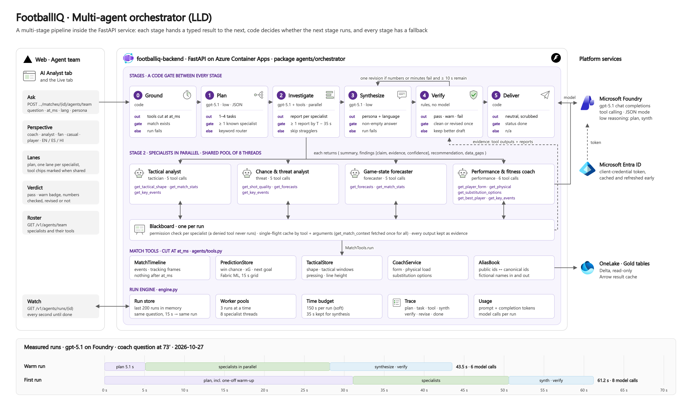
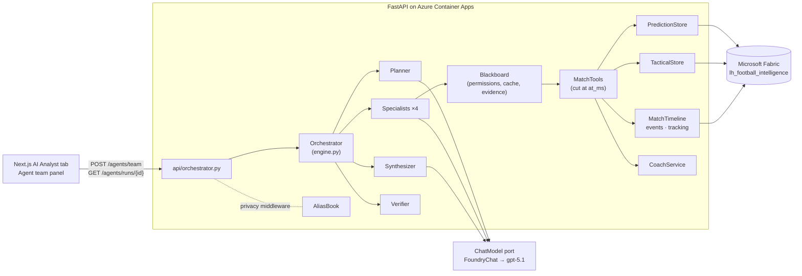
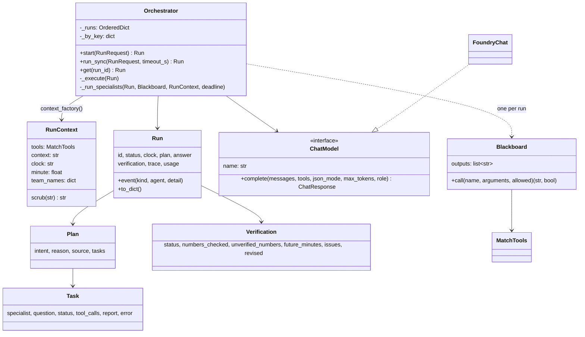
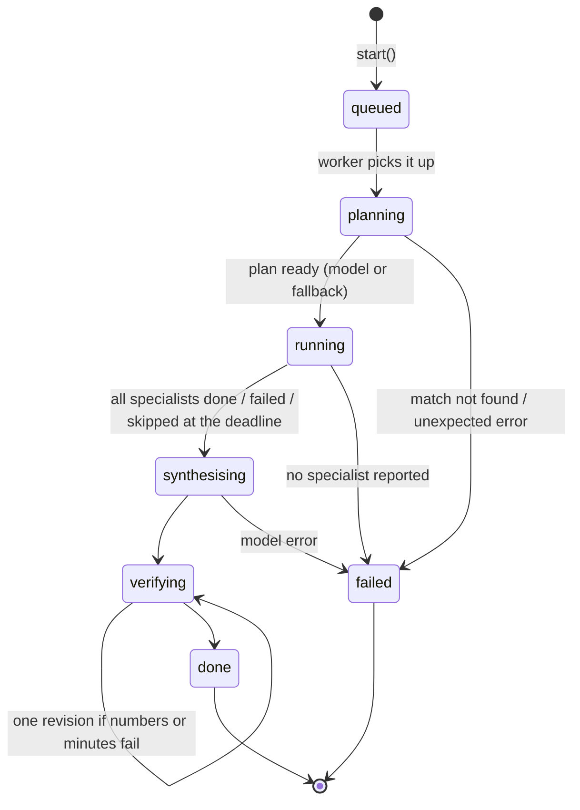
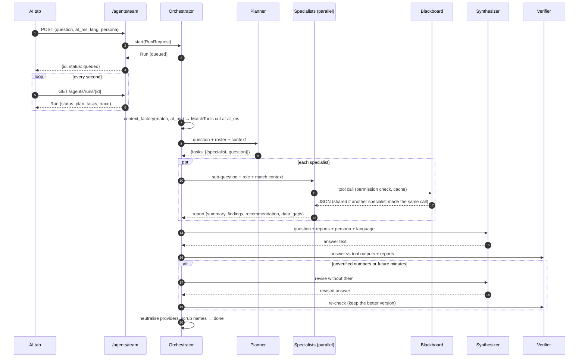
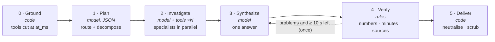

# Multi-agent orchestrator: low-level design

**Status:** implemented (`backend/footballiq/agents/orchestrator/`, `backend/footballiq/api/orchestrator.py`), tested offline
(`backend/tests/test_orchestrator.py`) and live against Microsoft Foundry (gpt-5.1).
**Companion:** the high-level design and product roadmap is in [MULTI_AGENT_HLD.md](MULTI_AGENT_HLD.md).

---

## 1. Purpose

One question from a coach, analyst or fan ("Azuria just pulled one back: what should Solaria do in the next ten
minutes?") usually needs several kinds of evidence: shape and control from tracking, chance quality and forecasts from
the models, fatigue and substitution options from the coach analytics. A single agent with ten tools tends to call two
of them and answer from those. The orchestrator splits the work:

1. a **planner** decides which specialists the question needs and what each must find out;
2. **specialists** work in parallel, each with its own tools, on a shared, clock-bounded blackboard;
3. a **synthesizer** writes one answer in the user's language and perspective;
4. a deterministic **verifier** checks the answer against the evidence before anyone sees it (one revision round).

Every step is recorded in a trace that the UI polls, so the user watches the team work.

### Requirements

| # | Requirement | How it is met |
|---|---|---|
| F1 | Answer free-text questions about the match at the replay clock | `POST /v1/matches/{id}/agents/team` |
| F2 | Route to the right expertise; several when needed | Planner (model) + keyword fallback router |
| F3 | Show progress live | Run store + trace events, `GET /v1/agents/runs/{id}` |
| F4 | Answer in English, Spanish or Hindi, for coach / analyst / fan / casual / player | Synthesizer persona + language |
| S1 | Nothing after the replay clock may be used | All tools are `MatchTools` cut at `at_ms`; verifier rejects future minutes |
| S2 | Fictional names only; never real identities or data providers | Alias book on tool input/output and final text; shared rules; verifier neutralises provider names |
| S3 | Every number must come from the data | Specialists copy numbers from tool outputs; verifier grounds every number; one revision |
| N1 | p50 ≤ 60 s end to end, live progress within 1 s | Parallel specialists, per-role reasoning effort, polling |
| N2 | Bounded cost and load | Tool budgets per specialist, ≤ 4 specialists, run de-duplication, bounded pools |
| N3 | Degrade, never crash | Fallbacks per stage (§10) |

---

## 2. Where it sits



[SVG](architecture/06-multi-agent-lld.svg). The same view as the other architecture diagrams: the stages with their output,
gate and fallback, the four specialists and their tool permissions, the blackboard, the clock-bounded match tools, the
run engine, and two measured runs. How the team connects to the rest of FootballIQ is in
[the HLD diagram](architecture/05-multi-agent-hld.png).



The orchestrator **reuses** the clock-bounded tool layer of the existing Foundry agents (`agents/tools.py`): the same ten
functions, the same alias translation, the same cut at the replay clock. It does not replace the single Strategist and
Moment Explainer agents; it sits beside them (the UI offers "Single analyst" and "Agent team").

---

## 3. Package layout

| Module | Responsibility |
|---|---|
| `agents/orchestrator/models.py` | Plain dataclasses: `RunRequest`, `Run`, `Plan`, `Task`, `Verification`, `TraceEvent`; enums `RunStatus`, `TaskStatus`; `Run.to_dict()` is safe to serialise mid-run |
| `agents/orchestrator/llm.py` | `ChatModel` port, `FoundryChat` adapter (Entra auth, retries, per-role reasoning effort), message helpers, tolerant `parse_json` |
| `agents/orchestrator/registry.py` | The team: `Specialist` entries (role, brief, tool permissions, budget); planner, specialist-output, synthesizer and revision prompts; personas and languages |
| `agents/orchestrator/blackboard.py` | Shared tool access for one run: permission check, single-flight cache, evidence log |
| `agents/orchestrator/roles.py` | `plan()` + `fallback_plan()`, `run_specialist()` tool loop, `synthesize()`, report normalisation |
| `agents/orchestrator/verifier.py` | Number grounding, future-minute check, provider-name neutralisation |
| `agents/orchestrator/engine.py` | `Orchestrator`: run store, de-duplication, worker pools, deadlines, the pipeline, tracing |
| `api/orchestrator.py` | Routes, request model, `context_factory` (builds a `RunContext` from the `AgentService`) |
| `agents/service.py` | `AgentService.tools_for()` (public accessor used by the orchestrator) |



---

## 4. Data model

### RunRequest

| Field | Type | Notes |
|---|---|---|
| `match_id` | str | Canonical id (the privacy middleware translates the public `m-…` id in the path) |
| `at_ms` | int ≥ 0 | Replay clock. Every tool is cut here |
| `question` | str ≤ 2000 | Whitespace-normalised; real names scrubbed before any model sees it |
| `lang` | `en` \| `es` \| `hi` | Answer language (specialists always work in English) |
| `persona` | `coach` \| `analyst` \| `fan` \| `casual` \| `player` | Tone and depth of the answer |
| `fav_team_id` | str \| None | Fan perspective: supported team (public `t-…` id accepted) |

`cache_key(bucket_ms)` = (match, `at_ms // 15000`, lower-cased question, lang, persona, fav team): identical questions in the
same 15-second window share one run.

### Run (what the API returns)

```jsonc
{
  "id": "run-3f9c1a2b7d4e", "status": "done", "clock": "73'", "seconds": 43.5, "model": "gpt-5.1", "error": null,
  "request": {"question": "...", "at_ms": 4830000, "lang": "en", "persona": "coach", "fav_team_id": null, "match_id": "m-fd6bpy"},
  "plan": {"intent": "manage the next 10 minutes", "reason": "...", "source": "model",
           "tasks": [{"specialist": "tactician", "question": "...", "status": "done", "seconds": 19.5, "model_calls": 2,
                      "tool_calls": [{"name": "get_key_events", "arguments": {}, "cached": true, "chars": 2310, "ok": true}],
                      "report": {"summary": "...", "findings": [{"claim": "...", "evidence": "...", "confidence": "high"}],
                                 "recommendation": "...", "data_gaps": []},
                      "error": null}]},
  "answer": "One-sentence answer.\n- bullet …\nRecommendation: …\nConfidence: high - …",
  "verification": {"status": "pass", "numbers_checked": 16, "unverified_numbers": [], "future_minutes": [], "issues": [], "revised": false},
  "trace": [{"t": 5.1, "kind": "plan", "agent": "planner", "detail": "model: tactician, threat, performance - …"}],
  "usage": {"prompt_tokens": 25100, "completion_tokens": 3328, "model_calls": 8}
}
```

`trace.kind` ∈ `plan | task_start | tool | task_done | task_failed | synth | verify | revise | done | error`; `t` is seconds
since the run started.

---

## 5. Run lifecycle





---

## 5a. The multi-stage pattern

The orchestrator is a **multi-stage agent pipeline**. Each stage does one job and hands a typed object to the next.
Code, not a model, decides whether the next stage runs, and every stage has a fallback. As a result each stage can be
tested on its own, timed on its own in the trace, and replaced without touching the others: a stage can be a model,
rules, or both.



| Stage | Kind | Input → output | Gate to the next stage | Fallback | Run status / trace |
|---|---|---|---|---|---|
| 0 Ground | code | `RunRequest` → `RunContext` (MatchTools cut at `at_ms`, context text, clock, minute, team names) | match exists | run `failed: match … not found` | `planning` |
| 1 Plan | model, `low` reasoning, JSON mode, ≤ 900 tokens | question + roster + context → `Plan` (1–4 tasks) | ≥ 1 valid task | keyword router | `plan` |
| 2 Investigate | model + tools, parallel, ≤ 1400 tokens per call, 5–6 tool calls each | `Task` + `Blackboard` → report JSON | ≥ 1 report by `deadline − 35 s` | task `failed` / `skipped`; run fails only if none reports | `running`; `task_start`, `tool`, `task_done` |
| 3 Synthesize | model, `low` reasoning, ≤ 1200 tokens | question + reports + persona + language → text | non-empty text | run `failed` | `synthesising`; `synth` |
| 4 Verify | deterministic rules | text + evidence + minute → `Verification` | pass, or the revision is used up, or < 10 s left | one revision (back to stage 3), the better version wins | `verifying`; `verify`, `revise` |
| 5 Deliver | code | text → answer | n/a | n/a | `done` |

### Which named patterns it combines

| Pattern (as named in Anthropic's "Building effective agents" and Microsoft Agent Framework orchestrations) | Where it appears |
|---|---|
| Prompt chaining / sequential orchestration | Stages 0 → 5, each output is the next input |
| Routing | Stage 1 picks specialists (model, with a keyword router as fallback) |
| Orchestrator–workers + concurrent (fan-out / fan-in) | Stage 1 writes sub-questions, stage 2 runs them in parallel, stage 3 joins them |
| Blackboard (shared memory) | Stage 2: one tool cache and evidence log for all specialists |
| Evaluator–optimizer (reflection) | Stage 4 → 3. The evaluator is deterministic rules, not an LLM judge, so it cannot be talked round |

**Patterns not used, and why:**

- **Group chat** (agents take turns in one conversation). It needs more model calls, is hard to bound in time, and agents
  converge on the first opinion stated.
- **Handoff** (the conversation moves to one agent). It suits a chat where the user talks to one expert at a time, but here
  one question needs several experts at once.
- **Magentic** (a manager re-plans from a task ledger). It suits open-ended tasks with unknown steps. Match questions
  have a known shape, and the 150 s deadline matters more than open-ended re-planning.

### Rules that keep the stages independent

- **Typed hand-offs.** Each boundary is a dataclass or a string (`RunContext`, `Plan`, report dict, answer, `Verification`).
  No stage reads another stage's prompt or message history.
- **Independent workers.** Specialists never see each other's reports, which avoids herding. Only the synthesizer sees
  all of them, and it is told which specialists could not report.
- **Code gates.** Whether the next stage runs is decided by code; model judgement is not trusted for that.
- **Per-stage resources.** Each model stage has its own reasoning effort (§6) and token cap, and each stage has its own
  deadline: stage 2 must end by `deadline − synth_reserve_s`, so stages 3–5 always have time.
- **Observable.** Every stage emits trace events, so the UI's timeline shows the stages as they run.

Adding a stage (for example a fast path in stage 1 that answers trivial questions directly, or an LLM critic between
stages 3 and 4) is a function in `roles.py` plus one call in `Orchestrator._execute` (§15).

---

## 6. Roles

### 6.1 Planner (`roles.plan`)

- **Input:** shared rules + roster (`key: title - brief` per specialist) + replay context; the user's question.
- **Output contract (JSON mode):** `{"intent", "tasks": [{"specialist", "question"}], "reason"}`.
- **Validation:** unknown specialist keys, duplicates and empty sub-questions are dropped; at most 4 tasks.
- **Fallback (`fallback_plan`):** if the call fails or yields no valid task, a keyword router picks specialists
  (`ROUTES` in `roles.py`); a question that matches nothing goes to tactician + threat + forecaster. `plan.source` records
  which path was used.
- **Reasoning effort:** `low` (routing needs little reasoning; measured 5–7 s vs 8 s at default).

### 6.2 Specialists (`roles.run_specialist`)

| Key | Title | Tools (permissions) | Budget |
|---|---|---|---|
| `tactician` | Tactical analyst | match context, tactical shape, match stats, key events | 5 calls |
| `threat` | Chance & threat analyst | match context, shot quality, forecasts, key events | 5 calls |
| `forecaster` | Game-state forecaster | match context, forecasts, match stats | 5 calls |
| `performance` | Performance & fitness coach | match context, player form, physical, substitution options, best player, key events | 6 calls |

Algorithm:

```text
ctx := blackboard.call("get_match_context")             # once per run, shared, injected into the prompt
messages := [system(rules + role + output contract + replay context + ctx), user(sub-question)]
calls := 0
repeat up to budget+2 rounds:
    if now > deadline: raise Timeout
    resp := model.complete(messages, tools = allowed tools if calls < budget else none,
                           json_mode = calls >= budget)
    if resp has no tool calls: return normalise(parse_json(resp.content) or {summary: text})
    for each tool call: calls += 1
        if calls > budget: reply {"unavailable": "tool budget used up"}
        elif tool not permitted: reply {"error": "not one of your tools"}           # never executed
        else: reply blackboard.call(name, args)                                      # cached or executed
        record {name, arguments, cached, chars, ok}; emit trace "tool"
    if calls >= budget: append "Tool budget used. Reply now with the JSON report."
```

Report contract (normalised): `summary`, 2–5 `findings {claim, evidence, confidence}`, `recommendation | null`,
`data_gaps[]`. Reports are internal (English); only the synthesizer's text reaches the user.

### 6.3 Synthesizer (`roles.synthesize`)

- **Input:** shared rules + persona + language; the question; all reports keyed by specialist title; the specialists
  that could not report (so it can say what is missing).
- **Format:** the same as the single Strategist (first line answers; 2–4 bullets with number + source; `Recommendation:`;
  `Confidence: high|medium|low - why`), so the UI renders both with one component. Labels stay in English in every language.
- **Personas** (`registry.PERSONA`): coach (one coachable action), analyst (numbers first, with sources), fan (warm,
  partisan "we" for the supported team, honest numbers), casual (no jargon), player (what to do next on the pitch).
- **Reasoning effort:** `low` (measured: write-up from verified findings does not need deep reasoning).

### 6.4 Verifier (`verifier.verify`), deterministic

| Check | Rule |
|---|---|
| Grounding | Every number in the answer (except minutes and model versions) must appear in the evidence: all tool outputs of the run, the specialists' reports and the replay context. Evidence numbers are expanded with rounding to 0/1/2 decimals and, for values ≤ 1, as percentages (0.231 → 23.1 / 23). Tolerance: ±0.051 or 1 %. Values 0 and 1 are skipped unless written as a percentage |
| Formations and scores | Tokens like `4-3-3` and `2-2` must appear as written in the evidence, or every part must be grounded |
| No future | Every minute mention (`73'`, `90+3'`) must be ≤ the current minute (stoppage minutes order as 90.03 etc.) |
| Neutral sources | Data-provider and vendor names are replaced (`neutralise`) and reported as issues |

Outcome: `pass`, `warn` (unverified numbers or provider names) or `fail` (future minutes). If anything is unverified
and at least 10 s of the deadline remain, the synthesizer gets **one** revision request listing the problems; the
version with fewer problems wins (future minutes weigh 3×). `revised: true` is reported either way.

---

## 7. Blackboard (`blackboard.py`)

- **Permissions:** `call(name, args, allowed)` raises `ToolDenied` for a tool outside the specialist's list; the loop
  turns it into an error message for the model. Denied tools are never executed.
- **Single-flight cache:** key = (tool name, canonical JSON of arguments). The first caller executes, concurrent callers
  for the same key wait on an `Event` and share the result; later callers hit the cache (`cached: true` in the trace).
  In the live run, 2 of 9 calls were shared.
- **Clock safety:** the cache lives for one run, and the run's `MatchTools` is cut at that run's `at_ms`, so a cached
  result can never come from a later clock.
- **Evidence:** every distinct output text is appended to `outputs` for the verifier.
- **Privacy:** `MatchTools.run` already translates public ids in arguments to canonical ids and passes outputs through
  `AliasBook.to_public`; the model only ever sees public ids and fictional names.

---

## 8. API (`api/orchestrator.py`)

| Method | Path | Body / response |
|---|---|---|
| GET | `/v1/agents/team` | `{model, pipeline[], specialists[{key, title, brief, tools[]}]}` |
| POST | `/v1/matches/{match_id}/agents/team` | Body `{question, at_ms, lang?, persona?, fav_team_id?, wait?}` → `Run`. Returns immediately (`queued`) unless `wait: true` |
| GET | `/v1/agents/runs/{run_id}` | `Run`; `404` when unknown or evicted |

Errors: `422` invalid body (empty question, unsupported language or persona), `503` Foundry not configured (from
`agent_service()`), `404` unknown run. A run that fails returns `status: failed` with `error` (e.g. `match … not found`,
`ModelError: no specialist could report`). The privacy middleware maps canonical ids in every response to public ids.

Wiring (`api/app.py`): `app.state.orchestrator` is created lazily on first use with `FoundryChat()` and
`context_factory(agent_service().tools_for)`; tests inject an `Orchestrator` with a scripted model.

---

## 9. Concurrency, limits and caching

| Limit (`engine.Limits`) | Default | Purpose |
|---|---|---|
| `run_timeout_s` | 150 | Run time budget (soft). Specialists must finish by `deadline − synth_reserve_s`, and a revision only starts with ≥ 10 s left. Planner and synthesizer calls are not cut off |
| `synth_reserve_s` | 35 | Specialists must finish by `deadline − reserve`; stragglers become `skipped` |
| `max_concurrent_runs` | 3 | Run worker pool (protects model quota) |
| `max_specialist_workers` | 8 | Specialist pool shared by all runs |
| `cache_ttl_s` | 600 | A finished identical run is reused for 10 minutes |
| `bucket_ms` | 15 000 | Clock bucket for de-duplication |
| `max_runs_kept` | 200 | In-memory run store (oldest evicted) |

Threads, not asyncio: the model client and tool layer are synchronous (`httpx.Client`, numpy, pyarrow), FastAPI runs
the sync routes in its thread pool, and runs execute in their own pools so a slow model never blocks a request thread.
Python threads release the GIL during network I/O, which is where the time goes.

---

## 10. Failure modes

| Failure | Behaviour |
|---|---|
| Planner call fails or returns nothing usable | Keyword routing (`plan.source = fallback`) |
| A specialist errors (model error, bad JSON) | That task `failed`; others continue; synthesizer told what is missing. Bad JSON becomes `{summary: text}` |
| A specialist is too slow | `skipped` at `deadline − synth_reserve`; answer from the rest |
| The model is slow during planning or synthesis | Not cut off: each call has a 90 s HTTP timeout and up to 3 retries, so a run can pass 150 s (one UI test run took 215 s, with the forecaster skipped at its deadline) |
| No specialist reports | Run `failed: no specialist could report` |
| Tool unavailable (e.g. no tracking for the match) | Tool returns `{"unavailable": …}`; specialists list it under `data_gaps`; the answer says what is not available |
| Model 408/429/5xx | Up to 3 retries with exponential backoff (2, 4, 8 s, capped at 20 s) |
| Deployment without reasoning controls | First 400 mentioning reasoning disables `reasoning_effort` for the process |
| Ungrounded numbers / future minutes | One revision; result carries `verification.status` so the UI can badge it |
| Foundry not configured | `503` from the route; the UI shows a setup note |
| Process restart | Runs are in memory: the UI gets `404` for an old run id and can ask again |

---

## 11. Performance (measured, local, gpt-5.1, 2026-10-27)

| Run | Total | Planner | Specialists (parallel) | Synth + verify | Model calls | Tokens (prompt / completion) |
|---|---|---|---|---|---|---|
| First run after start (cold) | 61 s | 31 s incl. ~23 s one-off warm-up of the agent service and model stores | 10–20 s | 11 s | 8 | 25 100 / 3 328 |
| Warm, default reasoning | 43 s | 8.6 s | 11 s | 22.5 s | 6 | 15 764 / 1 851 |
| Warm, `low` for planner + synthesizer | 43 s | 5.1 s | 23 s | ~15 s | 6 | — |

Specialist time depends on how many tool rounds the model takes (1–3). Further levers: stream the synthesizer's text to
the UI; let the planner answer trivial questions directly; pre-warm the agent service at start-up (it is created lazily today).

---

## 12. Security and privacy

- **No future data:** enforced by construction (tools cut at `at_ms`) and checked (verifier).
- **Pseudonymisation:** question scrubbed (`AliasBook.scrub_text`) before any model call; tools see public ids and
  fictional names; the final answer is scrubbed again; responses pass the privacy middleware.
- **Provider neutrality:** shared rule 2 and the verifier's neutralisation.
- **Prompt injection:** tool outputs are data produced by our own code from our own tables; user text is length-capped
  and only ever placed in the user role; specialists cannot reach tools outside their permissions.
- **Secrets:** the model client uses the Foundry service principal from the environment (Container App secrets); no
  credential is ever logged or returned (the roster endpoint returns the deployment name only).

---

## 13. Testing (`tests/test_orchestrator.py`, offline, scripted model)

| Test | What it proves |
|---|---|
| `test_fallback_routing_by_keywords` | Router picks the right specialists; broad questions get three |
| `test_unusable_plan_falls_back_to_keywords` | Unknown specialist in the plan → keyword plan |
| `test_full_run_parallel_shared_tools_and_verified_answer` | End to end: tasks done, a duplicate tool call is shared, trace order, usage counted |
| `test_specialist_cannot_use_tools_outside_its_role` | Permission denial; denied tool never executed |
| `test_tools_are_cut_at_the_clock` | Tool outputs differ before and after a goal: the clock bound holds |
| `test_ungrounded_numbers_trigger_one_revision` | Invented number → revision → clean answer |
| `test_slow_specialist_is_skipped_at_the_deadline` | Deadline handling; run still completes |
| `test_identical_requests_share_one_run_and_unknown_match_fails_cleanly` | De-duplication; clean failure |
| `test_verifier_grounding_percentages_formations_and_future` | Percent conversion, formations, stoppage-time minutes, provider names |
| `test_api_team_endpoints` | Routes, validation, polling, 404 |

Live checks (manual): `curl -X POST localhost:8010/v1/matches/m-fd6bpy/agents/team -d '{"question": …, "at_ms": …, "wait": true}'`.

---

## 14. Configuration

| Variable | Default | Effect |
|---|---|---|
| `FOUNDRY_PROJECT_ENDPOINT`, `FOUNDRY_TENANT_ID`, `FOUNDRY_CLIENT_ID`, `FOUNDRY_CLIENT_SECRET` | — | Required (shared with the Foundry agents) |
| `FOOTBALLIQ_TEAM_MODEL` | `FOUNDRY_MODEL` (gpt-5.1) | Deployment used by the team |
| `FOOTBALLIQ_TEAM_REASONING_PLANNER` / `_SYNTHESIZER` / `_SPECIALIST` | `low` / `low` / model default | `none`, `low`, `medium`, `high` or `default` |

---

## 15. Extending

- **Add a specialist:** add a `Specialist(key, title, brief, focus, tools, max_tool_calls)` to `registry.SPECIALISTS`.
  The planner sees its `brief` automatically; add keywords to `roles.ROUTES` for the fallback; add a lane to the UI's icon map.
- **Add a tool:** implement `tool_<name>` on `MatchTools` (cut at `self.at_ms`!), add its spec to `TOOL_SPECS`, then
  grant it to specialists. The blackboard and verifier need no change.
- **Swap the model:** implement `ChatModel.complete` (e.g. another Foundry deployment, a small model for the planner).
- **Add a stage** (e.g. a critic agent before the deterministic verifier): a function in `roles.py` and a call in
  `Orchestrator._execute` between synthesis and verification, with its own trace kind.

## 16. Known limitations

- Runs live in memory per replica: with several replicas, polling must reach the same one (sticky sessions) or the run
  store must move to a shared cache. The deployed backend runs one replica.
- The verifier checks numbers and minutes, not the truth of a qualitative claim ("Azuria are wider").
- The 150 s budget is soft: only the specialists and the revision are bounded by it. A hard cap would need a per-call
  timeout derived from the time left.
- Specialists are not yet Foundry Agent Service agents (they run on chat completions with tool calling for speed and
  parallelism); the HLD discusses moving them onto Foundry multi-agent workflows and A2A.
